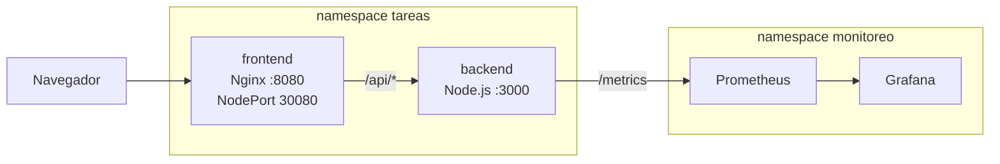
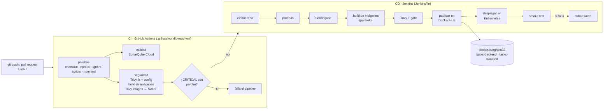

# Lab CI/CD — GitHub Actions, Jenkins, SonarQube y Trivy

[](https://github.com/Dghost32/lab-devsecops-killercoda/actions/workflows/ci.yml)

Laboratorio técnico de **Fundamentos de DevOps** (Maestría en Arquitectura de Software, Universidad de La Sabana): configuración de pipelines CI/CD con **GitHub Actions** y **Jenkins**.

Parte del laboratorio DevSecOps de la profesora María Fernanda Ochoa ([mafeopa/lab-devsecops-killercoda](https://github.com/mafeopa/lab-devsecops-killercoda)), con correcciones para que el CI pase en verde y un Jenkins reproducible en local.

La documentación técnica completa (justificación de herramientas, evidencias, hallazgos y capturas) está en **[docs/DOCUMENTACION.md](docs/DOCUMENTACION.md)**.

## Enlaces

| Qué | Dónde |
|---|---|
| Documentación técnica | [docs/DOCUMENTACION.md](docs/DOCUMENTACION.md) · [versión PDF](docs/DOCUMENTACION.pdf) |
| Capturas de los pipelines en ejecución | [docs/capturas/](docs/capturas/) |
| Ejecuciones del CI | [GitHub Actions](https://github.com/Dghost32/lab-devsecops-killercoda/actions/workflows/ci.yml) |
| Análisis estático | [Proyecto en SonarQube Cloud](https://sonarcloud.io/project/overview?id=Dghost32_lab-devsecops-killercoda) |
| Imágenes publicadas por Jenkins | [dghost32/tasks-backend](https://hub.docker.com/r/dghost32/tasks-backend/tags) · [dghost32/tasks-frontend](https://hub.docker.com/r/dghost32/tasks-frontend/tags) |
| Reportes de Trivy (antes y después) | [docs/evidencias/](docs/evidencias/) |

## La aplicación

API de tareas de dos capas: **frontend** (Nginx sin privilegios, puerto 8080) y **backend** (Node.js/Express, puerto 3000, con `/api/health`, `/api/tasks` y `/metrics` para Prometheus).



## Flujo CI/CD



| Etapa | Herramienta | Disparo | Resultado |
|---|---|---|---|
| **CI** | GitHub Actions | Cada `push` o `pull_request` a `main` | Pruebas, análisis estático y escaneo de seguridad. Falla si hay una vulnerabilidad CRITICAL con parche en cualquiera de las dos imágenes |
| **CD** | Jenkins | Manual o por *webhook* / *polling* del job | Imágenes versionadas `1.0.<build>` publicadas en Docker Hub y desplegadas en Kubernetes con rollback automático |

## Estructura del repositorio

| Ruta | Contenido |
|---|---|
| `.github/workflows/ci.yml` | Pipeline de CI: jobs `pruebas`, `calidad` y `seguridad` |
| `Jenkinsfile` | Pipeline de CD: 8 stages ([justificación de cada stage](docs/DOCUMENTACION.md#4-cd-con-jenkins)) |
| `jenkins/` | Imagen y configuración como código para correr el `Jenkinsfile` en local ([instrucciones](jenkins/README.md)) |
| `backend/`, `frontend/` | Código y `Dockerfile` de cada capa |
| `k8s/` | Namespace, Deployments y Services; `k8s/monitoring/` con Prometheus y Grafana |
| `sonar-project.properties` | Organización y proyecto de SonarQube Cloud |
| `scripts/` | Pasos 00 a 05 del laboratorio manual (Killercoda o local) |
| `docs/` | Documentación técnica, evidencias de Trivy y capturas |

## Cómo ejecutarlo

### CI (GitHub Actions)

Corre solo con cada `push` o `pull_request` a `main`. El análisis de SonarQube Cloud es **sin secretos** (*secretless*, OIDC): no hay `SONAR_TOKEN` guardado en el repositorio. Para configurarlo en un repositorio propio:

1. Importar el repositorio en [sonarcloud.io](https://sonarcloud.io), elegir el método de análisis **GitHub Actions** y desactivar *Automatic Analysis*.
2. En la organización de SonarQube Cloud: **Administration → Organization settings → Analysis →** activar *Secretless analysis for GitHub Actions*.
3. Ajustar `sonar.organization` y `sonar.projectKey` en `sonar-project.properties` (los usan Jenkins y el análisis local; el CI los recibe del intercambio OIDC).

En cada ejecución, `sonarqube-auth-action` cambia el token OIDC del job por un token de SonarQube de 30 minutos limitado al proyecto. Si la organización no tiene activado el modo *secretless*, el job falla en rojo en vez de saltarse el análisis.

### CD (Jenkins en local)

```bash
docker build -t lab-jenkins:local jenkins/
export JENKINS_ADMIN_PASSWORD="$(openssl rand -base64 18)"
docker run -d --name jenkins-lab --group-add 0 -p 127.0.0.1:8081:8080 \
  -v jenkins_lab_home:/var/jenkins_home -v /var/run/docker.sock:/var/run/docker.sock \
  -e JENKINS_ADMIN_PASSWORD lab-jenkins:local
```

Luego crear la credencial `dockerhub-creds` y lanzar **tasks-app-cd → Build with Parameters**. Detalle en [jenkins/README.md](jenkins/README.md).

### Laboratorio manual (Killercoda o Linux)

```bash
git clone https://github.com/Dghost32/lab-devsecops-killercoda.git lab && cd lab
chmod +x scripts/*.sh
./scripts/00-instalar-herramientas.sh   # kind, kubectl, Trivy, sysctl para SonarQube
./scripts/01-crear-cluster.sh           # clúster Kubernetes con kind
./scripts/02-sonarqube.sh               # SonarQube + análisis           → puerto 9000
./scripts/03-build-y-escaneo.sh         # pruebas, imágenes y Trivy
./scripts/04-desplegar.sh               # despliegue en K8s              → puerto 30080
./scripts/05-monitoreo.sh               # Prometheus 30090 / Grafana 30300
./scripts/verificar.sh                  # checklist final
```

### Ajustes para macOS (Docker Desktop, Apple Silicon)

| Paso | Ajuste |
|---|---|
| 0 | El script descarga binarios `linux-amd64`. Usar `brew install kind kubectl trivy` |
| 0 | `vm.max_map_count` (requisito de SonarQube) no existe en macOS: se fija dentro de la VM de Docker Desktop con `docker run --rm --privileged --pid=host alpine nsenter -t 1 -m -u -n -i sysctl -w vm.max_map_count=524288` (se pierde al reiniciar Docker) |
| 2 | `--network host` no funciona en Docker Desktop: usar `scripts/02-sonarqube-macos.sh`, que apunta el scanner a `http://host.docker.internal:9000` |
| Navegador | Si `localhost:30080` responde *400 Request Header Or Cookie Too Large* (cookies de otros proyectos en `localhost`), entrar por `http://127.0.0.1:30080` |

Limpieza: `kind delete cluster --name lab`, `docker rm -f sonarqube jenkins-lab`.

## Credenciales del laboratorio

| Servicio | Usuario | Contraseña |
|---|---|---|
| SonarQube local | admin | `DevOps2026!lab` |
| Grafana | admin | `devops2026` |
| Jenkins local | admin | La de `JENKINS_ADMIN_PASSWORD` al lanzar el contenedor |

Son credenciales de un entorno efímero de práctica. El CI no guarda ningún token: se autentica con SonarQube Cloud por OIDC. El token de Docker Hub vive solo en el almacén de credenciales de Jenkins; `.gitignore` excluye `.sonar-token` y `.env`.
