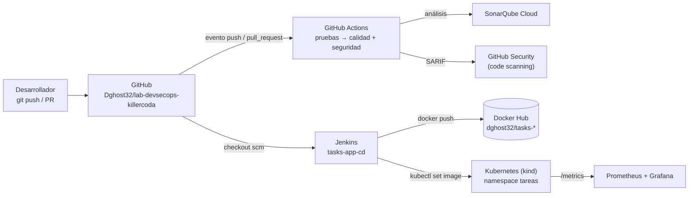
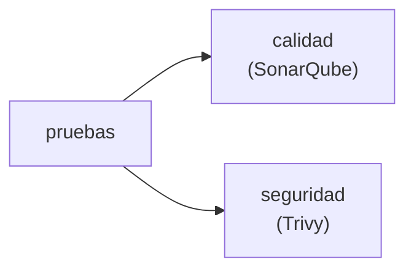
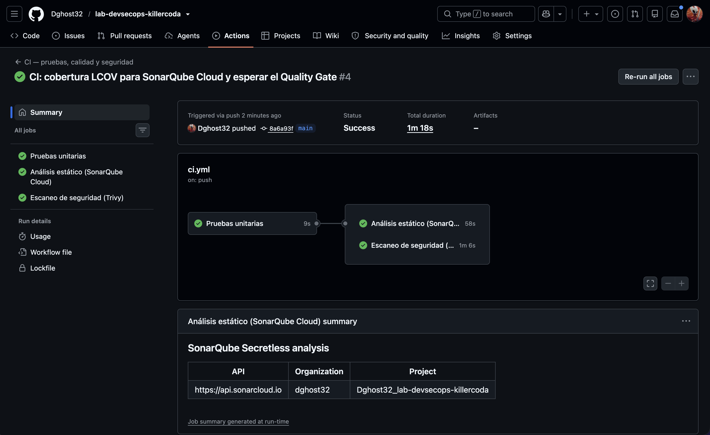
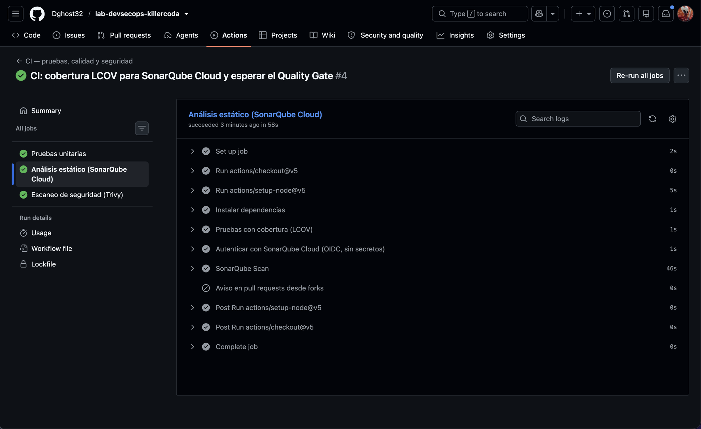
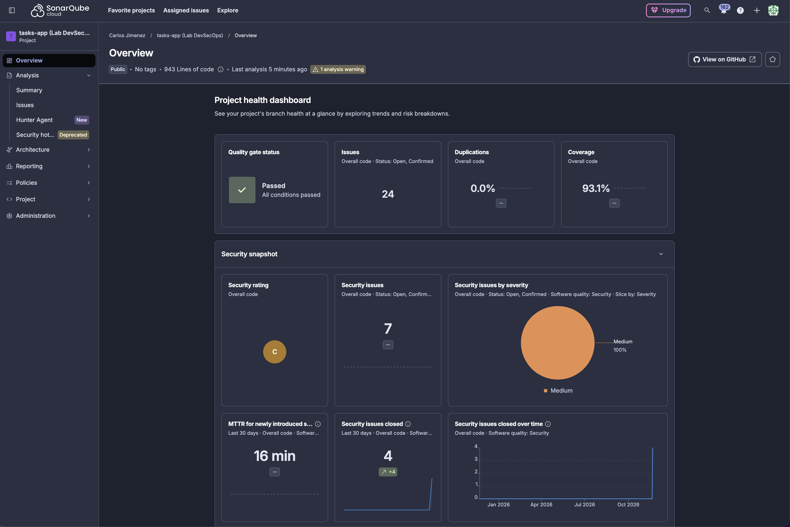
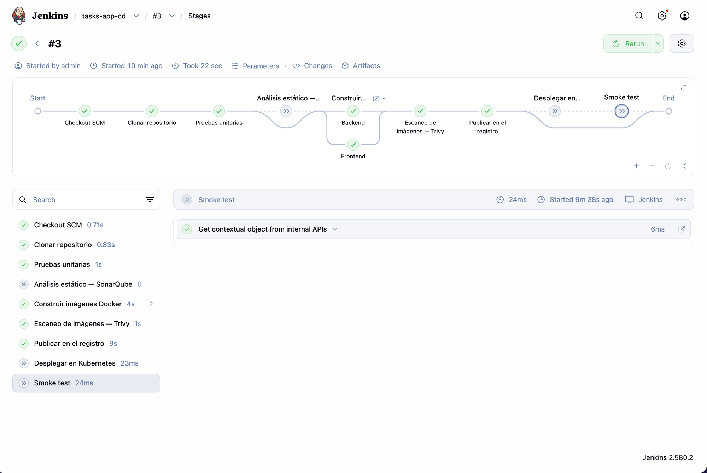
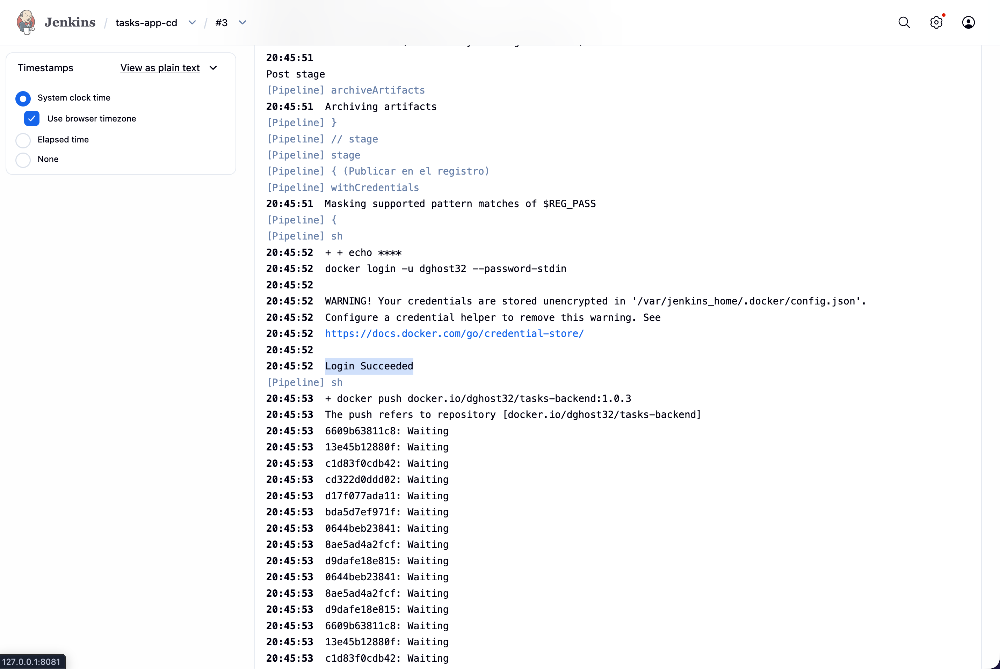
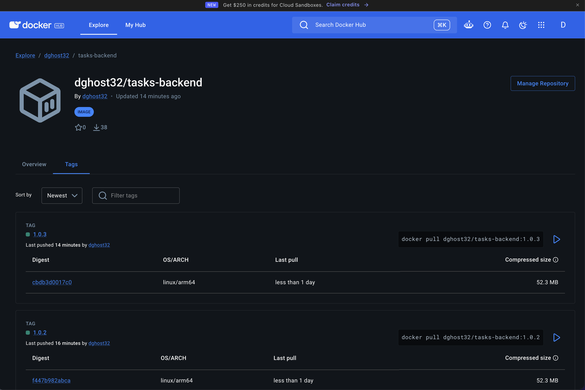

# Documentación técnica — Laboratorio de pipelines CI/CD

**Curso:** Fundamentos de DevOps · Maestría en Arquitectura de Software · Universidad de La Sabana
**Actividad:** Unidad 2, Actividad 3 — Laboratorio técnico: configuración de pipelines CI/CD con Jenkins y GitHub Actions
**Autor:** Carlos Jiménez
**Repositorio:** https://github.com/Dghost32/lab-devsecops-killercoda

---

## 1. Qué pide la guía y dónde está

| Requisito | Dónde se cumple |
|---|---|
| A. Repositorio con el código, `.github/workflows/ci.yml` y `README.md` del flujo | [Repositorio](https://github.com/Dghost32/lab-devsecops-killercoda): `backend/`, `frontend/`, [`ci.yml`](../.github/workflows/ci.yml), [`README.md`](../README.md) |
| B. CI en GitHub Actions en cada push o PR: checkout, dependencias y pruebas (análisis estático opcional) | Job `pruebas` (checkout, `npm ci --ignore-scripts`, `npm test`), más `calidad` (SonarQube Cloud) y `seguridad` (Trivy). [Sección 3](#3-ci-con-github-actions) |
| C. CD en Jenkins: clonar, construir imagen Docker y publicar en un registro | [`Jenkinsfile`](../Jenkinsfile) con 8 stages; publica en Docker Hub (`docker.io/dghost32`). [Sección 4](#4-cd-con-jenkins) |
| Capturas de los pipelines en ejecución | [Sección 7](#7-evidencias) |
| Justificación de herramientas | [Sección 5](#5-justificación-de-herramientas) |

## 2. Visión general

**División de responsabilidades:**
- **CI (GitHub Actions)** responde la pregunta *¿este cambio se puede integrar?* Corre en cada push y PR, no publica nada y no necesita credenciales de despliegue.
- **CD (Jenkins)** responde *¿cómo llega este cambio a un ambiente?* Construye, escanea, versiona y publica las imágenes, y despliega con rollback. Necesita credenciales (Docker Hub, clúster) que viven en Jenkins y no en el repositorio.

Las dos herramientas repiten pruebas y escaneo a propósito: Jenkins no confía en que el CI haya pasado, verifica lo que va a publicar. Así una imagen nunca llega al registro sin haber pasado el gate de Trivy en el mismo pipeline que la construyó.

## 3. CI con GitHub Actions

Archivo: [`.github/workflows/ci.yml`](../.github/workflows/ci.yml). Disparadores: `push` y `pull_request` a `main`, sin ejecución programada ni manual.

`calidad` y `seguridad` dependen de `pruebas` (`needs: pruebas`) y corren en paralelo entre sí: si las pruebas fallan, no se gasta tiempo en analizar ni en construir imágenes.

### Job `pruebas`

| Paso | Qué hace | Por qué |
|---|---|---|
| `actions/checkout@v5` | Descarga el commit que disparó el evento | Mínimo de la guía; todo se prueba sobre ese commit exacto |
| `actions/setup-node@v5` (Node 20, caché npm) | Instala Node.js y cachea `~/.npm` usando `package-lock.json` como llave | Misma versión que la imagen `node:20-alpine`. La caché acorta las ejecuciones siguientes |
| `npm ci --ignore-scripts` | Instala exactamente lo que dice el lockfile, sin ejecutar los scripts `preinstall`/`postinstall` de las dependencias | A diferencia de `npm install`, no modifica el lockfile y falla si no coincide con `package.json`: builds reproducibles. `--ignore-scripts` evita que una dependencia comprometida ejecute código al instalarse (ninguna dependencia del proyecto los necesita) |
| `npm test` | 6 pruebas con el runner nativo `node:test` y `fetch` contra la app levantada en un puerto efímero (health, listar, crear, validación 400, `/metrics`, sin cabecera `X-Powered-By`) | Mínimo de la guía; si falla, se cancela todo lo demás |

### Job `calidad` — SonarQube Cloud

| Paso | Qué hace | Por qué |
|---|---|---|
| `checkout` con `fetch-depth: 0` | Historia completa de git | Sonar la usa para atribuir *issues* a commits y detectar código nuevo |
| `SonarSource/sonarqube-auth-action@v1.2` (*secretless*) | Pide a GitHub un token OIDC del job y SonarQube Cloud lo cambia por un token de **30 minutos** limitado a este proyecto, que se exporta como `SONAR_TOKEN` | No hay ningún token guardado en el repositorio: nada que rotar, que dependa de una persona o que se pueda filtrar. El job tiene `id-token: write` y ningún otro job lo tiene |
| `SonarSource/sonarqube-scan-action@v8.5.0` | Analiza `backend/src` y `frontend` con la organización y el proyecto que devuelve el intercambio OIDC | SAST: bugs, *code smells*, *security hotspots* (como la contraseña quemada `ADMIN_PASSWORD` de `app.js`) |
| Aviso en PR desde forks | Si el PR viene de un fork, se omiten los dos pasos anteriores y se deja un `::notice::` | GitHub no entrega `id-token` a los PR de forks. El análisis corre cuando el cambio llega a `main` |

### Job `seguridad` — Trivy

| Paso | Qué hace | Por qué |
|---|---|---|
| Trivy `fs` (vuln + misconfig) | Escanea `package-lock.json`, Dockerfiles y manifiestos de Kubernetes | Detecta dependencias vulnerables y malas configuraciones **antes** de construir. Es informativo (`exit-code: 0`) |
| `docker build` backend y frontend | Construye las dos imágenes con la etiqueta `github.sha` | El escaneo de imagen ve lo que realmente se va a ejecutar: sistema operativo + dependencias |
| Trivy imagen backend → SARIF | Reporte HIGH/CRITICAL en formato SARIF | Se publica en la pestaña *Security → Code scanning* del repositorio, donde queda el historial de alertas |
| `upload-sarif@v4` (`if: always()`) | Sube el SARIF aunque un paso anterior falle | La evidencia se conserva incluso cuando el pipeline se rompe |
| **Quality gate** backend y frontend | `--severity CRITICAL --ignore-unfixed --exit-code 1` | Bloquea el merge si hay una vulnerabilidad CRITICAL **con parche disponible**. `ignore-unfixed` evita bloquear por algo que el equipo no puede corregir todavía |

**Buenas prácticas aplicadas:**
- Las actions de terceros (`aquasecurity/trivy-action` y las dos de SonarSource) están fijadas a un **commit SHA** y no a una etiqueta, para protegerse de que alguien mueva la etiqueta a código comprometido.
- `permissions` mínimos: `contents: read` en todo el workflow; los permisos de escritura van solo en el job que los usa: `security-events: write` en `seguridad` (subir el SARIF) e `id-token: write` en `calidad` (OIDC).
- **Sin secretos de larga duración en el CI:** la autenticación con SonarQube Cloud es por OIDC.
- Ningún paso interpola datos controlados por el usuario (títulos de PR, mensajes de commit) en comandos `run:`.

## 4. CD con Jenkins

Archivo: [`Jenkinsfile`](../Jenkinsfile) (pipeline declarativo). La justificación de cada stage y de su posición está en la tabla siguiente, no en comentarios del código.

| # | Stage | Qué hace | Por qué ahí |
|---|---|---|---|
| 1 | **Clonar repositorio** | `checkout scm` del repo y la rama configurados en el job | Todo se construye a partir del commit del repositorio, nunca de archivos sueltos del agente |
| 2 | **Pruebas unitarias** | `npm ci --ignore-scripts && npm test` en `backend/` | Lo más barato primero: si la lógica falla, no se construye ni se escanea nada |
| 3 | **Análisis estático — SonarQube** | `sonar-scanner-cli` en contenedor, token desde la credencial `sonar-token` | Quality gate de código antes de empaquetarlo. Usar la imagen oficial evita instalar el scanner en el agente |
| 4 | **Construir imágenes Docker** | `docker build` de backend y frontend **en paralelo**, etiqueta `1.0.<BUILD_NUMBER>` | Son independientes, así que en paralelo se ahorra tiempo. La etiqueta por build hace que cada imagen sea inmutable y trazable a su ejecución |
| 5 | **Escaneo de imágenes — Trivy** | Reportes HIGH/CRITICAL archivados como artefactos y gate CRITICAL sobre las dos imágenes | Se escanea la imagen final **antes** de publicarla: lo vulnerable no llega al registro |
| 6 | **Publicar en el registro** | `docker login --password-stdin` con la credencial `dockerhub-creds`, `docker push` y `docker logout` | Solo se publica lo que pasó pruebas y escaneo. El token no aparece en el log ni en la lista de procesos |
| 7 | **Desplegar en Kubernetes** | `kubectl apply`, `set image` a la versión nueva y `rollout status` | El *rolling update* reemplaza pods sin downtime; `rollout status` espera a que las *probes* confirmen que los pods están listos |
| 8 | **Smoke test** | `curl` a `http://frontend/api/health` desde un pod efímero | Valida el camino completo frontend → proxy Nginx → backend dentro del clúster |
| — | `post { failure }` | `kubectl rollout undo` de backend y frontend (si se intentó desplegar) | Si el despliegue o el smoke test fallan, el clúster vuelve a la versión anterior sin intervención manual |

**Opciones del pipeline:** `timestamps()` (auditoría), `timeout(30 min)` (evita builds colgados), `buildDiscarder(20)` (no llena el disco) y `disableConcurrentBuilds()` (dos despliegues simultáneos se pisarían).

**Parámetros `ANALISIS_SONAR`, `PUBLICAR` y `DESPLEGAR`:** por defecto están en `true`, así que el pipeline completo es el comportamiento normal. Existen para correr el mismo `Jenkinsfile` en ambientes sin parte de la infraestructura (un Jenkins local sin clúster, por ejemplo). Las etapas apagadas se marcan como *skipped* y no como fallidas.

**Entorno de ejecución local** ([`jenkins/`](../jenkins/README.md)): imagen `jenkins/jenkins:lts-jdk21` con Docker CLI, Node.js 20 y Trivy, configurada como código con JCasC (usuario admin, sin acceso anónimo y el job `tasks-app-cd` creado al arrancar desde este repositorio). Sin `JENKINS_ADMIN_PASSWORD`, el contenedor no arranca.

## 5. Justificación de herramientas

| Herramienta | Rol | Por qué esta y no otra |
|---|---|---|
| **GitHub Actions** | CI | Vive en el mismo lugar que el código: sin servidores que mantener, se dispara con eventos nativos (push, PR), los secrets se guardan cifrados por repositorio y el resultado se ve en el PR. Para un proyecto alojado en GitHub es la opción con menos fricción. Gratis para repositorios públicos |
| **Jenkins** | CD | Autoalojado: corre dentro de la red donde están el clúster y el registro, sin exponerlos a Internet, que es lo normal en despliegues *on-premise*. Tiene un almacén de credenciales propio, un ecosistema de plugins muy amplio y pipelines como código (`Jenkinsfile`) versionados con la app. Es el estándar de facto en organizaciones con infraestructura propia |
| **SonarQube (Cloud)** | Análisis estático (SAST) | Detecta bugs, *code smells*, duplicación y *security hotspots* en el código fuente, con *quality gates* configurables. La versión Cloud es gratuita para repositorios públicos y se integra con GitHub sin instalar servidor. En local se usó SonarQube Community en Docker |
| **Trivy** | Escaneo de vulnerabilidades y configuración | Una sola herramienta cubre dependencias (`fs`), imágenes de contenedor (`image`) y configuración de Dockerfile y Kubernetes (`config`). Es open source, rápida, sin servidor, y exporta SARIF para GitHub Security. Complementa a SonarQube: Sonar mira el código propio y Trivy lo que se hereda (librerías e imagen base) |
| **Docker** | Empaquetado | La misma imagen corre en el portátil, en el CI y en el clúster. El `Dockerfile` documenta y versiona el entorno de ejecución |
| **Docker Hub** | Registro de imágenes | Registro público por defecto de Docker: no requiere configuración extra en `docker push`/`pull` ni en Kubernetes, y tiene un plan gratuito con *personal access tokens* de permisos acotados |
| **Kubernetes (kind)** | Orquestación y ambiente de despliegue | kind levanta un clúster real de Kubernetes dentro de Docker en segundos: el mismo API y los mismos manifiestos que en producción, sin costo de nube. Aporta *rolling updates*, *probes*, `securityContext` y rollback nativo (`rollout undo`), que el pipeline aprovecha |
| **Prometheus + Grafana** | Monitoreo | El backend expone `/metrics` con `prom-client`; Prometheus lo recolecta y Grafana lo grafica con PromQL. Cierra el ciclo DevOps con retroalimentación desde operación |

## 6. Hallazgos y correcciones

### 6.1 El quality gate de Trivy fallaba por una CVE CRITICAL heredada

**Síntoma:** el job `seguridad` del repositorio original fallaba en *Quality gate — bloquear si hay CRITICAL*.

**Causa:** la vulnerabilidad no estaba en el código de la app sino en la **imagen base**: `node:20-alpine` trae npm, y npm incluye `tar` 6.2.1 con **CVE-2026-59873** (CRITICAL, denegación de servicio por *gzip bomb*, corregida en 7.5.19). La app corre con `node src/server.js` y no usa npm en tiempo de ejecución.

**Corrección** ([`backend/Dockerfile`](../backend/Dockerfile)):
1. Borrar npm, npx, yarn y corepack de la imagen después de `npm ci --omit=dev --ignore-scripts`. Además de quitar la CVE, reduce la superficie de ataque: un atacante dentro del contenedor no tiene gestor de paquetes.
2. `apk upgrade --no-cache` para aplicar los parches de openssl, musl y zlib publicados después de la imagen base.
3. `lodash` de `4.17.15` a `4.18.1`. La última 4.17.x (4.17.23) todavía tenía **CVE-2026-4800** (HIGH, ejecución de código vía `template`), corregida en 4.18.0. La app solo usa `sortBy` y `maxBy`, así que el cambio de versión menor no tiene impacto y las pruebas pasan.

**Frontend** ([`frontend/Dockerfile`](../frontend/Dockerfile)): `nginx-unprivileged:1.27-alpine` pasa a `1.29-alpine` más `apk upgrade` (como root solo durante ese `RUN` y luego `USER 101`). Con las dos imágenes limpias, el gate se extendió también al frontend en el CI y en el `Jenkinsfile`.

**Resultado** (Trivy 0.76.2, severidades HIGH y CRITICAL; reportes completos en [`docs/evidencias/`](evidencias/)):

| Imagen | Antes | Después | Gate CRITICAL |
|---|---|---|---|
| `tasks-backend` | 1 CRITICAL, 32 HIGH | **0 CRITICAL, 0 HIGH** | falla → **pasa** |
| `tasks-frontend` | 3 CRITICAL, 65 HIGH | **0 CRITICAL, 0 HIGH** | (no se evaluaba) → **pasa** |
| Dependencias `backend/` (`trivy fs`) | 4 HIGH (lodash) | **0** | — |

### 6.2 El análisis de SonarQube se saltaba siempre

El commit `bf5b129` del repositorio original cambió el `ci.yml` a `secrets.SONAR_TOKE` y `if: env.SONAR_TOKE != ''`. Como el job define la variable `SONAR_TOKEN`, la condición nunca era verdadera y el paso se omitía sin error: una **falla silenciosa**, porque el pipeline salía verde sin analizar nada. Primera corrección: `SONAR_TOKEN` en las tres líneas y `sonar.organization`/`sonar.projectKey` apuntando a la organización propia.

**Corrección definitiva — análisis *secretless*:** el problema de fondo era depender de un secreto cuyo nombre tenía que coincidir en tres lugares, y de una condición que, si fallaba, saltaba el análisis sin avisar. Con OIDC desaparecen el secreto y la condición: el job siempre intenta autenticarse y, si SonarQube Cloud rechaza el intercambio, **falla en rojo** en vez de pasar en verde sin analizar. La única excepción explícita son los PR desde forks, que dejan un aviso visible.

### 6.3 Pods del backend en `CreateContainerConfigError` (`runAsNonRoot`)

- **Síntoma** al desplegar en kind: `container has runAsNonRoot and image has non-numeric user (node), cannot verify user is non-root`.
- **Causa:** el Deployment exige `runAsNonRoot: true`, pero el Dockerfile declara `USER node`, un **nombre** y no un UID. El kubelet no puede resolver nombres dentro de la imagen, así que no puede verificar que no sea root y se niega a arrancar el contenedor.
- **Corrección:** `runAsUser: 1000` (UID de `node` en la imagen oficial) en el `securityContext` de [`k8s/10-backend.yaml`](../k8s/10-backend.yaml), y `USER 1000` en lugar de `USER node` en el [`backend/Dockerfile`](../backend/Dockerfile), para que la imagen sea verificable por sí sola en cualquier clúster.
- **Lección:** un control de seguridad correcto (no correr como root) rompe el despliegue si la imagen y el manifiesto no están alineados. Validar los manifiestos contra la imagen antes de desplegar (*shift left*) lo habría detectado antes.

### 6.4 Problemas resueltos al montar Jenkins

| Problema | Causa | Solución |
|---|---|---|
| `permission denied` en `/var/run/docker.sock` | En Docker Desktop el socket es `root:root 660` | `--group-add 0` al usuario `jenkins`, sin correr Jenkins como root |
| `buildWithParameters` respondía 400 en el primer build | Jenkins registra los `parameters` del `Jenkinsfile` solo después de ejecutarlo una vez | Declarar los mismos parámetros en la definición del job (JCasC/Job DSL) |
| El admin podía quedar con contraseña vacía si faltaba la variable | JCasC sustituye una variable inexistente por cadena vacía | `entrypoint.sh` aborta el arranque si `JENKINS_ADMIN_PASSWORD` falta o tiene menos de 12 caracteres |
| Los stages de SonarQube y despliegue fallarían en local | El agente local no tiene `kubectl` ni servidor Sonar | Parámetros `ANALISIS_SONAR`/`DESPLEGAR` con `when { expression { ... } }` |

### 6.5 Hallazgos de SonarQube Cloud

El primer análisis completo en SonarQube Cloud (run `44946432460`) pasó el *Quality Gate*, que en el primer análisis evalúa todo el código como nuevo, y dejó 28 *issues* abiertos: 11 vulnerabilidades, 1 bug y 16 *code smells*.

**Corregidos:**

| Regla | Dónde | Corrección |
|---|---|---|
| Permiso de escritura a nivel de workflow | `ci.yml` | `security-events: write` pasó del workflow al job `seguridad`. Así `pruebas` y `calidad` no reciben un token que puede escribir alertas de seguridad |
| `npm ci` sin `--ignore-scripts` | `ci.yml`, `backend/Dockerfile`, `Jenkinsfile` | Se agrega `--ignore-scripts`: los *lifecycle scripts* de una dependencia comprometida no se ejecutan en el runner, en el agente de Jenkins ni durante el `docker build`. Ninguna dependencia del lockfile declara scripts de instalación |
| Express expone su versión | `backend/src/app.js` | `app.disable('x-powered-by')`, con una prueba que verifica que la cabecera ya no aparece |

**Pendientes** (ver la [sección 9](#9-limitaciones-y-trabajo-futuro)):

| Regla | Dónde | Por qué no se corrigió en esta entrega |
|---|---|---|
| Credencial quemada | `k8s/monitoring/prometheus-grafana.yaml` (`GF_SECURITY_ADMIN_PASSWORD`) | Es parte del stack de monitoreo del laboratorio original; la solución es un `Secret` de Kubernetes creado fuera del repositorio |
| *Service account* montado automáticamente | `k8s/10-backend.yaml`, `k8s/20-frontend.yaml`, Grafana | Se corrige con `automountServiceAccountToken: false`; las apps no llaman a la API de Kubernetes |
| Sin `requests` de almacenamiento efímero | Los mismos Deployments | Se corrige con `resources.requests.ephemeral-storage` |
| Descargas `curl` sin forzar HTTPS en redirecciones | `scripts/00-instalar-herramientas.sh` | Se corrige con `curl --proto '=https'`; el script solo se usa para preparar la máquina del laboratorio |
| `<input>` sin `<label>` | `frontend/index.html` | Accesibilidad, no seguridad |
| `[` en lugar de `[[` en condicionales | Scripts de bash | *Code smell* de estilo; no cambia el comportamiento |

## 7. Evidencias

### 7.1 GitHub Actions

- Ejecuciones: https://github.com/Dghost32/lab-devsecops-killercoda/actions/workflows/ci.yml

### 7.2 Jenkins

### 7.3 Docker Hub

### 7.4 Reportes de Trivy

| Archivo | Contenido |
|---|---|
| [`trivy-backend-antes.txt`](evidencias/trivy-backend-antes.txt) | Imagen del backend antes de la corrección: CVE-2026-59873 en `tar` |
| [`trivy-backend-despues.txt`](evidencias/trivy-backend-despues.txt) | Imagen del backend después: sin HIGH ni CRITICAL |
| [`trivy-frontend-antes.txt`](evidencias/trivy-frontend-antes.txt) | Imagen del frontend con `nginx-unprivileged:1.27-alpine` |
| [`trivy-frontend-despues.txt`](evidencias/trivy-frontend-despues.txt) | Imagen del frontend con `1.29-alpine` y parches |
| [`trivy-config.txt`](evidencias/trivy-config.txt) | Hallazgos de configuración en Dockerfiles y manifiestos (sección 8) |

### 7.5 Ejecución manual del laboratorio (macOS)

Antes de automatizar se corrió cada herramienta a mano, en un Mac con Apple Silicon y Docker Desktop:

| Paso | Resultado |
|---|---|
| Clúster kind | Nodo `lab-control-plane` Ready (Kubernetes 1.37, arm64) |
| SonarQube local | **Quality Gate OK**: 0 bugs, 0 vulnerabilidades, 1 *security hotspot* (`ADMIN_PASSWORD`), 1 *code smell* |
| Pruebas | 5 de 5 |
| Despliegue | 2 pods de backend y 2 de frontend `Running` tras la corrección de `runAsNonRoot` |
| Monitoreo | Prometheus recolecta los 2 pods del backend; Grafana grafica `sum by (status) (rate(http_requests_total[1m]))` |

## 8. Manejo de secretos

| Secreto | Dónde vive | Cómo se usa |
|---|---|---|
| Token de SonarQube Cloud | **No existe un token guardado.** Se genera en cada ejecución por OIDC (*secretless*), dura 30 minutos y solo sirve para este proyecto | `sonarqube-auth-action` lo exporta como `SONAR_TOKEN` para el paso siguiente; GitHub lo enmascara en los logs |
| Token de Docker Hub | Credencial `dockerhub-creds` en Jenkins (PAT con permiso *Read & Write*) | `withCredentials` + `docker login --password-stdin` |
| Contraseña del admin de Jenkins | Variable de entorno al lanzar el contenedor | Leída por JCasC; nunca se versiona |
| Token del SonarQube local | `.sonar-token` (local) | Excluido en `.gitignore` |

## 9. Limitaciones y trabajo futuro

- **Configuración de Kubernetes:** Trivy reporta 10 hallazgos HIGH en los manifiestos (`readOnlyRootFilesystem` sin definir y `securityContext` por defecto en frontend y monitoreo). Corregirlos requiere montar `emptyDir` en las rutas que escriben Nginx y Prometheus.
- **Hallazgos abiertos de SonarQube Cloud:** credencial de Grafana quemada en el manifiesto, *service accounts* montados sin necesidad, `curl` sin `--proto '=https'` y *code smells* de estilo en los scripts (detalle en la [sección 6.5](#65-hallazgos-de-sonarqube-cloud)).
- **Node.js 20 llegó a fin de vida (abril 2026).** La imagen pasa el escaneo hoy, pero el siguiente paso es migrar a Node 22 o 24 LTS.
- **Build multi-stage del backend:** hoy la imagen borra npm, npx, yarn y corepack después de instalar (sección 6.1). Lo de fondo es instalar las dependencias en una etapa de build y ejecutar en una imagen sin gestor de paquetes (por ejemplo distroless `nodejs`), para que el borrado no haga falta.
- **Builds en el nodo controlador de Jenkins:** el pipeline corre en el *built-in node*, algo aceptable solo en un laboratorio local. En producción el controlador queda con 0 ejecutores y los builds corren en agentes o pods efímeros, para que un build no pueda leer la configuración ni las credenciales del controlador.
- **Jenkins sobre Java 21:** Jenkins deja de soportarlo a partir del 30 de septiembre de 2027; la imagen base pasaría a `jenkins/jenkins:lts-jdk25`.
- **Cobertura de pruebas en SonarQube es 0 %:** falta generar el reporte LCOV (`node --test --experimental-test-coverage`) y pasarlo con `sonar.javascript.lcov.reportPaths`.
- **El stage de despliegue no se ejecutó desde Jenkins:** el contenedor de Jenkins no tiene `kubectl` ni acceso al clúster de kind. El despliegue sí se validó manualmente con `scripts/04-desplegar.sh`. La guía califica la definición de los stages, no su ejecución.
- **PR desde forks sin análisis de SonarQube:** consecuencia de usar OIDC. Se analiza al hacer merge a `main`. Si el proyecto recibiera muchas contribuciones externas, se usaría un flujo `workflow_run` separado.
- **Disparo automático de Jenkins:** en local se lanza a mano; con un Jenkins accesible desde Internet se conectaría con un *webhook* de GitHub o con `pollSCM`.
